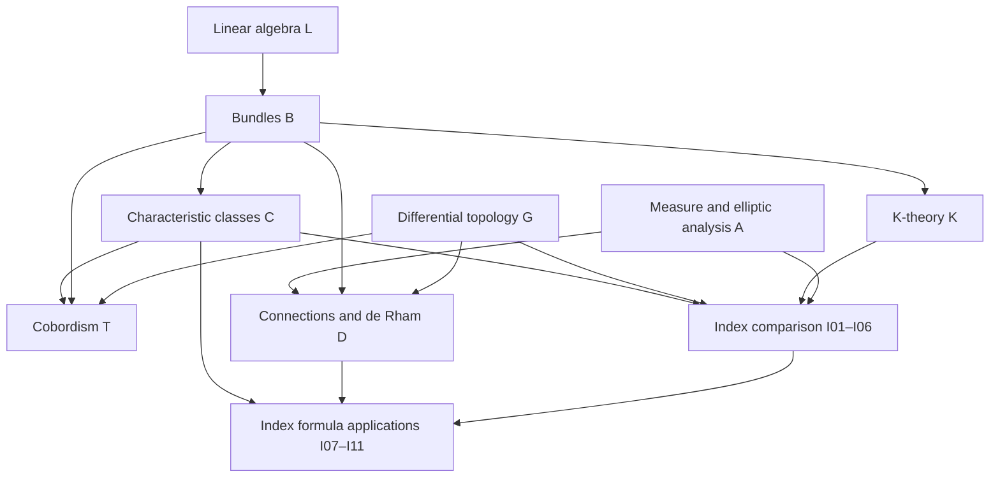

# Mathematics library roadmap

Develop characteristic classes, cobordism, and complex K-theory toward the Atiyah–Singer theorem for complex elliptic operators on closed compact manifolds and its index formulas.
Task specifications list Requirements, Dependencies, and an optional Status for outstanding work.
Existing implementations and their notes are linked from Requirements; the API map and check status provide an overview.

## Repository layout and available foundations

The [library index](../libs/README.md) covers the 112 packages in [libs/ref.toml](../libs/ref.toml).
Use package READMEs for APIs, source files for exact assumptions, and [checking instructions](../libs/USAGE.md) for the compiler in `ref-type/`.
Detailed constructions, proof explanations and historical validation records are in the [package notes](package-notes/README.md).
Notes separate Construction, Examples, and Historical validation, omitting empty sections.
Retained raw reports and logs are in [records](records).
A retained specification or README alone does not establish task completion.

## Goals and proof routes

Characteristic classes: finite-CW bundles → Thom isomorphisms → projective bundle/splitting principles → Chern, Stiefel–Whitney, Pontryagin, and Euler classes and characteristic numbers.
Morse functions and handles extend this route to compact smooth manifolds; de Rham comparison identifies topological classes with connection/curvature classes.

Cobordism: unoriented, oriented, and framed groups/products, finite-stage Thom spectra, Pontryagin–Thom, characteristic-number invariants, and nonzero examples.

K-theory: complex bundles → relative groups → Bott periodicity via Laurent approximation, spectral splitting, and clutching → compact supports and Koszul Thom isomorphisms.
Keep Bott independent of the index theorem.

The analytic index route uses measure, Fourier, Sobolev, pseudodifferential operators, parametrices, and Fredholm theory.
The topological route uses Euclidean embeddings, cotangent normal complex structures, Thom maps, and Bott isomorphisms.
Compare the indices through excision and Thom compatibility, then derive Chern-character formulas, Gauss–Bonnet, signature, and Spin-c Dirac applications.

Dependencies determine implementation order; the index theorem does not require cobordism-ring computations.

## Estimates and completion units

Tasks were sized at roughly 5,000 lines of new or substantially rewritten `.ref`, including proofs, comparisons, and examples; table values are in thousands of lines.
Treat 3,000–7,000 lines as a planning range, excluding documentation and generated code.
Reassess large or uncertain tasks, especially transversality, Bott linearization, pseudodifferential operators, and analytic Thom comparisons; split out reusable lemmas when needed.

A completion unit includes constructions from mathematical objects, explicit assumptions and laws, naturality, examples, and target/dependency-closure checks.
Update dependencies, workspace registration, and public documentation together.
Retain useful specifications, linking downstream work to published APIs.
Record requirement gaps separately from unverified scope, and record source/checker identity and results as described in [validation records](../libs/USAGE.md#validation-records).

## Implementation progress and check status

No type checks were run during the 2026-11-25 documentation cleanup.
The following upstream records refer to historical sources and do not establish current workspace acceptance.

| Task | Status and evidence |
| --- | --- |
| [G06](g06-tubular-neighborhoods.md#status) | Tubular/collapse APIs exist; boundary extensions, choice comparisons, stabilization, and examples need verification. Current package/closure checks are unconfirmed; the B08 workspace run stopped here. |
| [A09](a09-euclidean-sobolev.md#status) | Sobolev APIs exist; general weak-derivative comparison, coefficient classes, and examples need verification. Current package/closure checks are unconfirmed; the G13 workspace run stopped here. |
| [B08](b08-grassmannian-cells.md) | Later [2026-11-20 evidence](package-notes/geometry/grassmannian_cells.md#historical-validation) supersedes parse-only status: 225 target modules checked, 7,852 closure modules accepted; workspace runs incomplete. |
| [G13](g13-morse-lemma.md) | [2026-11-19 evidence](package-notes/geometry/morse_lemma.md#historical-validation): 137 target modules rechecked, 1,926 closure modules accepted; workspace stopped in A09 with 8,002 targets unverified. |

The older [C01 workspace report](records/c01-workspace.json) is `internal-error` with no verified modules.
[A01](package-notes/analysis/measure_convergence.md#historical-validation) and [C01](package-notes/topology/singular/cap.md#historical-validation) summarize historical work; unconfirmed checks alone do not imply a current source failure.

## Implementation workflow

Choose work by direct dependencies, available APIs, and validation coverage.
Update package dependencies, registration, documentation, examples, and check evidence together.

## Published API map

Existing APIs, with requirement and check gaps recorded separately above.

| Unit | Public API |
| --- | --- |
| A01 | [measure_convergence](../libs/analysis/measure_convergence/README.md) |
| A02 | [euclidean_measure](../libs/analysis/euclidean_measure/README.md) |
| A03 | [product_integration](../libs/analysis/product_integration/README.md) |
| A04 | [change_of_variables](../libs/analysis/change_of_variables/README.md) |
| A05 | [lp_spaces](../libs/analysis/lp_spaces/README.md) |
| A06 | [fourier_schwartz](../libs/analysis/fourier_schwartz/README.md) |
| A07 | [fourier_l2](../libs/analysis/fourier_l2/README.md) |
| A08 | [distributions](../libs/analysis/distributions/README.md) |
| A09 | [euclidean_sobolev](../libs/analysis/euclidean_sobolev/README.md) |
| A11 | [fredholm_operators](../libs/analysis/fredholm_operators/README.md) |
| A19 | [complex_hilbert](../libs/analysis/complex_hilbert/README.md) |
| B01 | [vector_bundles](../libs/geometry/vector_bundles/README.md) |
| B02 | [bundle_operations](../libs/geometry/bundle_operations/README.md) |
| B03 | [bundle_complements](../libs/geometry/bundle_complements/README.md) |
| B04 | [bundle_homotopy](../libs/geometry/bundle_homotopy/README.md) |
| B05 | [grassmannians](../libs/geometry/grassmannians/README.md) |
| B06 | [bundle_classification](../libs/geometry/bundle_classification/README.md) |
| B07 | [smooth_bundles](../libs/geometry/smooth_bundles/README.md) |
| B08 | [grassmannian_cells](../libs/geometry/grassmannian_cells/README.md) |
| B09 | [bundle_extension](../libs/geometry/bundle_extension/README.md) |
| C01 | [singular_cap](../libs/topology/singular/cap/README.md) |
| C02 | [thom_spaces](../libs/topology/thom_spaces/README.md) |
| C03 | [cohomology_thom](../libs/topology/cohomology_thom/README.md) |
| D01 | [bundle_connections](../libs/geometry/bundle_connections/README.md) |
| G01 | [smooth_partitions](../libs/geometry/smooth_partitions/README.md) |
| G02 | [inverse_implicit](../libs/geometry/inverse_implicit/README.md) |
| G03 | [boundary_manifolds](../libs/geometry/boundary_manifolds/README.md) |
| G04 | [manifold_gluing](../libs/geometry/manifold_gluing/README.md) |
| G05 | [compact_embeddings](../libs/geometry/compact_embeddings/README.md) |
| G06 | [tubular_neighborhoods](../libs/geometry/tubular_neighborhoods/README.md) |
| G13 | [morse_lemma](../libs/geometry/morse_lemma/README.md) |
| I10 | [spinor_representations](../libs/algebra/spinor_representations/README.md) |
| K01 | [topological_k_theory](../libs/topology/k_theory/README.md) |
| K02 | [puppe_sequences](../libs/topology/puppe_sequences/README.md) |
| K03 | [relative_k_theory](../libs/topology/relative_k_theory/README.md) |
| K04 | [uniform_approximation](../libs/analysis/uniform_approximation/README.md) |
| K05 | [complex_polynomial_roots](../libs/algebra/complex_polynomial_roots/README.md) |
| K06 | [spectral_splitting](../libs/algebra/spectral_splitting/README.md) |
| K07 | [clutching_linearization](../libs/topology/clutching_linearization/README.md) |
| K08 | [bott_product](../libs/topology/bott_product/README.md) |
| K09 | [periodic_k_theory](../libs/topology/periodic_k_theory/README.md) |
| K10 | [compact_support_k](../libs/topology/compact_support_k/README.md) |
| K11 | [k_theory_thom](../libs/topology/k_theory_thom/README.md) |
| K13 | [fundamental_algebra](../libs/algebra/fundamental_algebra/README.md) |
| L01 | [matrix_invariants](../libs/algebra/matrix_invariants/README.md) |
| L02 | [polynomial_linear_algebra](../libs/algebra/polynomial_linear_algebra/README.md) |
| L03 | [hermitian_frames](../libs/algebra/hermitian_frames/README.md) |
| L04 | [characteristic_series](../libs/algebra/characteristic_series/README.md) |

## Task list

The 70 retained planning entries total an original estimate of 367,000 lines, including implemented and uninvestigated work.
Use the [API map](#published-api-map) and [check status](#progress-and-checks) to assess remaining work.

### Linear algebra and characteristic series

| Task | Estimate (thousands of lines) |
| --- | ---: |
| [L04 Symmetric polynomials and characteristic series](l04-symmetric-series.md) | 5 |

### Vector bundles

| Task | Estimate (thousands of lines) |
| --- | ---: |
| [B05 Finite Grassmannians and universal bundles](b05-grassmannians.md) | 5 |
| [B06 Bundle classifying maps and stabilization](b06-bundle-classification.md) | 5 |
| [B08 Grassmannian cell decompositions](b08-grassmannian-cells.md) | 6 |

### Characteristic classes

| Task | Estimate (thousands of lines) |
| --- | ---: |
| [C01 Cap products and relative products](c01-cap-products.md) | 5 |
| [C02 Disk bundles, sphere bundles, and Thom spaces](c02-thom-spaces.md) | 5 |
| [C03 Thom classes and the Thom isomorphism](c03-thom-isomorphism.md) | 5 |
| [C04 Cohomology of projective spaces and canonical line bundles](c04-projective-cohomology.md) | 5 |
| [C05 Projective bundle theorem and splitting principle](c05-projective-bundle.md) | 5 |
| [C06 Chern classes](c06-chern-classes.md) | 5 |
| [C07 Stiefel–Whitney classes](c07-stiefel-whitney.md) | 5 |
| [C08 Comparing Pontryagin and Euler classes](c08-pontryagin-euler.md) | 5 |
| [C09 Chern character and multiplicative characteristic classes](c09-chern-character-genera.md) | 5 |
| [C10 Characteristic numbers and concrete manifolds](c10-characteristic-numbers.md) | 5 |
| [C11 Leray–Hirsch comparison](c11-leray-hirsch.md) | 5 |
| [C12 Compactly supported cohomology](c12-compact-support-cohomology.md) | 5 |

### Topological K-theory

| Task | Estimate (thousands of lines) |
| --- | ---: |
| [K08 Bott's basic product theorem](k08-bott-product.md) | 5 |
| [K10 Compactly supported K-theory and symbol presentations](k10-compact-support-k.md) | 6 |
| [K11 Thom isomorphism in K-theory](../libs/topology/k_theory_thom/README.md) | 5 |
| [K12 Comparing the Chern character and Thom classes](k12-chern-character-thom.md) | 6 |

### Differential topology

| Task | Estimate (thousands of lines) |
| --- | ---: |
| [G01 Smooth bump functions and partitions of unity](g01-smooth-partitions.md) | 5 |
| [G02 Inverse and implicit functions and local forms of regular values](../libs/geometry/inverse_implicit/README.md) (implemented) | 5 |
| [G03 Manifolds with boundary and corners](g03-boundary-manifolds.md) | 5 |
| [G04 Collars and boundary gluing](../libs/geometry/manifold_gluing/README.md) (implemented) | 5 |
| [G05 Embeddings of compact manifolds](../libs/geometry/compact_embeddings/README.md) | 5 |
| [G06 Tubular neighborhoods and collapse maps](g06-tubular-neighborhoods.md#status) (implemented; requirements pending verification; checks unconfirmed) | 5 |
| [G07 Sard's theorem](g07-sard.md) | 6 |
| [G08 Smooth approximation and relative transversality](g08-transversality.md) | 6 |
| [G09 Morse functions and noncritical intervals](g09-morse-functions.md) | 5 |
| [G10 Handle decompositions and finite CW type](g10-handles-finite-cw.md) | 5 |
| [G11 Orientations and fundamental classes](g11-fundamental-classes.md) | 5 |
| [G12 Poincaré–Lefschetz duality](g12-poincare-duality.md) | 5 |
| [G13 Local analysis of the Morse lemma](g13-morse-lemma.md) | 5 |

### Cobordism

| Task | Estimate (thousands of lines) |
| --- | ---: |
| [T01 Geometric cobordism groups and products](t01-geometric-bordism.md) | 5 |
| [T02 Stable homotopy classes and Thom spectra](t02-stable-thom.md) | 6 |
| [T03 Pontryagin–Thom collapse maps](t03-pontryagin-thom-collapse.md) | 5 |
| [T04 Pontryagin–Thom isomorphism](t04-pontryagin-thom-isomorphism.md) | 6 |
| [T05 Cobordism invariance of characteristic numbers](t05-bordism-invariants.md) | 5 |
| [T06 Concrete cobordism computations](t06-bordism-examples.md) | 4 |

### Connections and differential forms

| Task | Estimate (thousands of lines) |
| --- | ---: |
| [D02 Curvature and Chern–Weil classes](d02-chern-weil.md) | 5 |
| [D03 Integration on manifolds and Stokes' theorem](d03-integration-stokes.md) | 5 |
| [D04 De Rham comparison theorem](d04-de-rham-comparison.md) | 5 |
| [D05 Agreement of topological characteristic classes and characteristic forms](d05-characteristic-form-comparison.md) | 5 |

### Measure, functional analysis, and elliptic operators

| Task | Estimate (thousands of lines) |
| --- | ---: |
| [A01 Convergence theorems for measure integration](a01-measure-convergence.md) | 5 |
| [A02 Lebesgue measure on Euclidean spaces](a02-lebesgue-measure.md) | 6 |
| [A03 Product measures and Fubini](a03-product-integration.md) | 5 |
| [A05 Norms and completeness of Lp spaces](a05-lp-completeness.md) | 5 |
| [A06 Schwartz spaces and the Fourier transform](a06-schwartz-fourier.md) | 6 |
| [A09 Sobolev estimates on Euclidean spaces](a09-euclidean-sobolev.md#status) (implemented; requirements pending verification; checks unconfirmed) | 6 |
| [A10 Rellich compactness](a10-rellich.md) | 5 |
| [A11 Fredholm operators and the index](a11-fredholm-operators.md) | 5 |
| [A12 Sobolev spaces of bundle sections](a12-bundle-sobolev.md) | 5 |
| [A13 Symbols and local quantization](a13-symbol-quantization.md) | 6 |
| [A14 Composition and coordinate changes of pseudodifferential operators](a14-symbol-calculus.md) | 6 |
| [A15 Sobolev boundedness of pseudodifferential operators](a15-pseudodifferential-bounds.md) | 6 |
| [A16 Elliptic parametrices and regularity](a16-elliptic-parametrix.md) | 6 |
| [A17 Analytic index of elliptic operators](a17-elliptic-fredholm.md) | 5 |
| [A18 Analytic normalization of the Bott operator](a18-bott-operator.md) | 6 |
| [A19 Complex Hilbert spaces and compact operators](a19-complex-hilbert.md) | 5 |

### Index theorem and applications

| Task | Estimate (thousands of lines) |
| --- | ---: |
| [I01 Symbol K-classes and the analytic index map](i01-symbol-index.md) | 5 |
| [I02 Localization and excision of the analytic index](i02-analytic-excision.md) | 6 |
| [I03 Analytic index and Thom maps](i03-analytic-thom.md) | 6 |
| [I04 Topological index map](i04-topological-index.md) | 5 |
| [I05 Atiyah–Singer index theorem](i05-atiyah-singer.md) | 4 |
| [I06 Cohomological index formula](i06-cohomological-index.md) | 5 |
| [I07 Hodge theory and the signature operator](i07-hodge-signature.md) | 6 |
| [I08 Spin-c Dirac operator](i08-spin-dirac.md) | 5 |
| [I09 Gauss–Bonnet, signature, and Dirac index formulas](i09-index-applications.md) | 6 |
| [I10 Complex spinor representations](i10-spinor-representations.md) | 5 |
| [I11 Spin and Spin-c structures and spinor bundles](i11-spin-structures.md) | 5 |

## Integration milestones

| Milestone | Completed tasks | Results |
| --- | --- | --- |
| Shared bundle foundations | B03, B04, [B07](../libs/geometry/smooth_bundles/README.md) | Sets of isomorphism classes, complements, homotopy invariance, existing tangent/normal comparisons |
| Topological characteristic classes | C08, C09, C10 | Integral, mod 2, and rational characteristic classes, characteristic numbers, projective-space computations |
| Topological K-theory | K09, K11, K12 | Periodicity, compactly supported Thom isomorphisms, Chern-character comparison |
| Cobordism | T04, T05, T06 | Pontryagin–Thom isomorphism, invariants, explicit nonzero classes |
| Characteristic forms | D05 | Agreement of topological characteristic classes and curvature forms |
| Analytic index | A17, I01 | Fredholm elliptic operators and the index on symbol K-groups |
| Index theorem | I05, I06 | Agreement of analytic and topological indices; cohomological expression |
| Index formula applications | I09 | Characteristic-class formulas for Euler characteristic, signature, and Spin-c Dirac index |

## Further development

Plan full unoriented cobordism-ring computations, oriented cobordism torsion, complex cobordism MU, and formal groups as additional Steenrod-operation, spectral-sequence, and stable-homotopy work.
Next K-theory stage: real K-theory and eightfold periodicity, real and mod 2 indices via KO, exterior powers, and Adams operations.
Beyond the index theorem: complex manifolds and Dolbeault theory toward Hirzebruch–Riemann–Roch, family and equivariant indices, boundaries and APS indices, and heat-kernel local index formulas.
Expand each stage into tasks of comparable size once its required foundations are clear.

## Proof references

For bundles, characteristic classes, and Bott, see [Hatcher, Vector Bundles & K-Theory](https://pi.math.cornell.edu/~hatcher/VBKT/VB.pdf).
For characteristic classes, Thom spaces, and cobordism, see [Haynes Miller, Algebraic Topology II](https://ocw.mit.edu/courses/18-906-algebraic-topology-ii-spring-2020/pages/lecture-notes/).
For the index construction via embeddings, excision, and Thom maps, compare [Landweber, K-theory and elliptic operators](https://arxiv.org/abs/math/0504555) and the Atiyah–Singer proofs it references.
Task divisions and line counts are design estimates based on the existing libraries.
