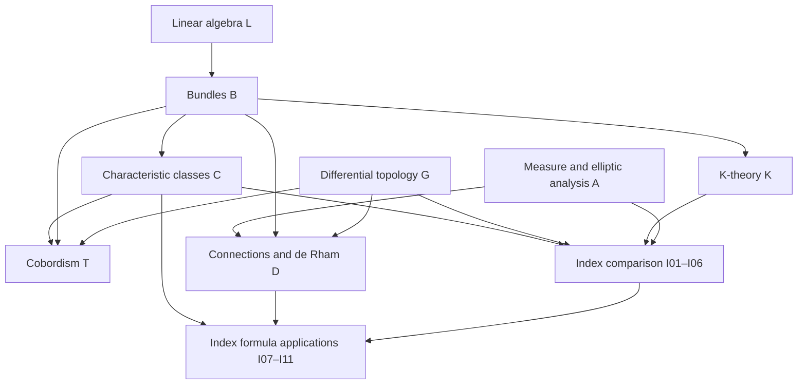

# Mathematics library roadmap

Develop characteristic classes, cobordism, and complex K-theory toward the Atiyah–Singer index theorem for complex elliptic operators on closed compact manifolds and concrete index formulas.
Each individual `.md` is an implementation task describing requirements and direct dependencies.
This file tracks overall scope, estimates, parallel work, and integration milestones.

## Starting point

Based on the existing libraries as of 2026-10-21.
Fundamental groups and coverings, homological algebra, and singular cohomology plans are complete; build on the public APIs in the [library index](../../libs/README.md).
Tangent and normal bundles, differential forms, Clifford algebras, Spin and Spin-c groups, and real Gram–Schmidt are also available.
Construct general vector bundles, tubular neighborhoods, manifolds with boundary, characteristic classes, and K-theory in these tasks.
Existing Lp and Sobolev work is mainly definitions; scope also includes Euclidean Lebesgue measure, completeness, Fourier analysis, and elliptic regularity.
Compare and reuse overlapping existing APIs during implementation.
Document public APIs in each library's README; track implementation progress and completion verification in the task list below.

## Goals and proof routes

For real and complex bundles over finite CW bases, develop characteristic classes through Thom isomorphisms, the projective bundle theorem, and the splitting principle to Chern, Stiefel–Whitney, Pontryagin, and Euler classes and characteristic numbers.
Apply these to compact smooth manifolds via finite CW types obtained from Morse functions and handle decompositions.
Develop connections and curvature separately, then identify their classes with topological characteristic classes through the de Rham comparison.

First-stage cobordism covers unoriented, oriented, and framed groups and products, the Pontryagin–Thom isomorphism, characteristic-number invariants, and explicit nonzero examples.
Construct Thom spectra from finite Grassmannian Thom spaces and stabilization, using set-valued finite-stage representatives.

Start K-theory with complex bundles on compact Hausdorff spaces, then relative theory, Bott periodicity, compact supports, and Thom isomorphisms via Koszul complexes.
Prove Bott periodicity via Laurent approximation, spectral splitting, and clutching.
Construct the analytic index afterward, avoiding circular dependencies between the index theorem and Bott periodicity.

The index theorem concerns elliptic pseudodifferential operators between complex bundles on closed compact smooth manifolds.
Analytic route: measure, Fourier, Sobolev, pseudodifferential operators, parametrices, and Fredholm theory.
Topological route: Euclidean embeddings, complex structures on cotangent normal bundles, Thom maps, and Bott isomorphisms to construct the topological index.
Compare both indices by compatibility of the analytic index with excision and Thom maps, then derive Chern-character formulas.
Applications: Gauss–Bonnet, Hirzebruch's signature formula, and the Spin-c Dirac index formula.

The diagram shows the main integration points between fields.
Use each task's dependency list to determine when work can begin.
Characteristic classes and K-theory proceed in parallel after the shared bundle foundations; the index theorem can proceed without waiting for cobordism-ring computations.

## Estimates and completion units

Each task is a design estimate centered on roughly 5,000 lines of new or substantially rewritten `.ref`, including proofs, comparison maps, and examples.
Tables use thousands of lines; documentation and generated code are counted separately.
Before measurement, use a rough range of 3,000–7,000 lines, depending on proof detail and existing API reuse.
For scale, current `field_kunneth` has roughly 4,200 lines and `singular_products` roughly 3,200 lines of `.ref`.
Estimates are particularly uncertain for transversality, Bott linearization, pseudodifferential operators, and analytic Thom comparisons.
Check dependency APIs and proof routes before assignment. If a task will greatly exceed 7,000 lines, split off additional tasks whose completion criterion is publication of independent lemmas.
An assigned task is one completion unit including its requirements, naturality, concrete examples, and dependency-closure checks.

Primary package names are provisional; follow existing placement within each field.
Build constructions from actual mathematical objects and expose proofs of existence, inverses, equalities, and exactness.
Quantify theorem objects and assumptions in propositions; group construction data and laws into structures.
Update direct dependencies, workspace members, README, and small examples; check targets and dependency closures using the [shared cache](../../src/USAGE.md#%E6%A4%9C%E6%9F%BB%E3%81%A8%E3%82%AD%E3%83%A3%E3%83%83%E3%82%B7%E3%83%A5).
On upstream completion, record its public API and check results in its README, replace downstream task links with the corresponding README, then remove the completed task.
Do not infer unstarted/completed status or API availability solely from remaining plans or README presence.
Assess progress against actual code and requirements; record known outstanding work separately from unverified scope.
Separately record type-check targets and dependency closure, source commit or snapshot, checker, and result references.
Mark completion only with evidence that requirements, comparisons, and examples are fulfilled and checks cover the target sources.
If evidence is unavailable, mark checks unconfirmed; source or cache presence does not prove success.
Assess dependencies against their public API, check status, and downstream needs.

## Implementation progress and check status

Read-only inspection of main `dce3d353e75972c507928253d6c33420f6f55a0f` on 2026-11-19 covered the following scope.
Both items below have workspace registration and actual implementations; work has started, but full-plan completion remains unconfirmed.
Other task statuses were not reinvestigated.

| Task | Implementation progress and outstanding verification | Type-check evidence |
| --- | --- | --- |
| [G06](g06-tubular-neighborhoods.md#status) | Implements tubular neighborhoods, continuous collapse, boundary preservation, comparison families within a fixed lift, and product/stabilization identities. The connection from neat embeddings to `Extension`, comparison generality, and stabilized normal Thom spaces remain unverified. README and standalone examples are missing. | Current G06 and dependency-closure success unconfirmed. |
| [A09](a09-euclidean-sobolev.md#status) | Code and README cover integer-order Fourier models, duality, weak-derivative comparison on Schwartz functions, support-restricted multiplication and coordinate changes, embedding, and smoothness. General \(H^k\)–\(W^{k,2}\) comparison, coefficient-class requirements, and standalone examples remain unverified. | Current A09 and dependency-closure success unconfirmed. |

Three snapshots remaining in `libs/refcache/.check-*` in the inspected environment omit G06/A09 sources and workspace registration and have no final reports.
The environment's `/workspace/.ref-type-toolchain/std-nat.json` is `accepted`, but targets `std`.
The repository's [existing full report](c01-integrated-workspace-report.json) is `internal-error` with empty `verified_modules`.
These do not demonstrate successful checks of current G06, A09, or the entire current library.
No type checking was run during this inspection; unconfirmed checks do not imply current source failures.

## Parallel assignment

Assign one task at a time to each available agent once all its dependencies are integrated.
Work on each task in a separate branch/worktree, scoped to its primary package.
Coordinate APIs and task ownership before changing shared foundations.
Include `libs/ref.toml` and library-index changes in each branch so it can be checked; reconcile registration and dependencies during integration.
Manage parallel implementation of independent tasks separately from integration order for shared files.
Downstream agents work on independent tasks until upstream integration, then connect to its public APIs.

Tasks available initially:

- [A01 Convergence theorems for measure integration](a01-measure-convergence.md)
- [A19 Complex Hilbert spaces and compact operators](a19-complex-hilbert.md)
- [B05 Finite Grassmannians and universal bundles](b05-grassmannians.md)
- [C01 Cap products and relative products](c01-cap-products.md)
- [G01 Smooth bump functions and partitions of unity](g01-smooth-partitions.md)
- [G02 Inverse and implicit functions and local forms of regular values](../../libs/geometry/inverse_implicit/README.md) (implemented)
- [L04 Symmetric polynomials and characteristic series](l04-symmetric-series.md)

L01 determinants/inverses, L02 polynomial factorization, and L03 Hermitian matrices/local frames are available. G02 [inverse_implicit](../../libs/geometry/inverse_implicit/README.md) exposes local inverses, parameterized implicit functions, constant-rank local forms, regular-value submanifolds, and tangent kernels.
B03 metrics, complements, and sets of isomorphism classes are available, enabling B05.
B09 [bundle_extension](../../libs/geometry/bundle_extension/README.md) exposes real and complex Tietze extension, neighborhood extension of bundles/maps/isomorphisms, shrinking comparisons, and stabilization for reuse in K03.
K06 continuous spectral splitting underpins B04 bundle comparisons; reuse it with B04 clutching in K07.
Reuse K01 Grothendieck rings, stable criteria, and contravariant pullback in K03 and K07.
K04 real and complex Stone–Weierstrass, Laurent approximation, and uniform matrix/bundle estimates are also available for K07.
K07 [clutching_linearization](../../libs/topology/clutching_linearization/README.md) exposes choice-independent spectral inverse classes, naturality, direct sums, and inverse identities for the basic product for K08.
K02 [puppe_sequences](../../libs/topology/puppe_sequences/README.md) exposes finite CW-pair cofibrations, natural Puppe sequences, and contravariant Hom exactness for K03, B08, C02, and T02.
K03 [relative_k_theory](../../libs/topology/relative_k_theory/README.md) exposes relative triples/reduced-group comparisons, negative-degree exact sequences, excision, Mayer–Vietoris, natural external products, and bundle disk/sphere pairs for K08.
B07 [smooth_bundles](../../libs/geometry/smooth_bundles/README.md) exposes real and complex smooth bundles, metrics, frame/associated bundles, and tangent/normal comparisons for [D01](../../libs/geometry/bundle_connections/README.md), G06, I11, T01, and A12.
B02 bundle operations also serve C05; A02 can follow A01.
Assign C01, L04, and A19 to available contributors to advance the long analytic route early.
Section numbers are identifiers; dependency lists determine implementation order.

## Completed units

| Unit | Public API |
| --- | --- |
| L01 Determinants and invertible matrices | [matrix_invariants](../../libs/algebra/matrix_invariants/README.md) |
| L02 Polynomial Euclidean algorithm and Cayley–Hamilton | [polynomial_linear_algebra](../../libs/algebra/polynomial_linear_algebra/README.md) |
| L03 Hermitian matrices and continuous local frames | [hermitian_frames](../../libs/algebra/hermitian_frames/README.md) |
| K13 Existence of complex polynomial roots | [fundamental_algebra](../../libs/algebra/fundamental_algebra/README.md) |
| K05 Fundamental theorem of algebra and continuity of root clusters | [complex_polynomial_roots](../../libs/algebra/complex_polynomial_roots/README.md) |
| B01 General real and complex vector bundles | [vector_bundles](../../libs/geometry/vector_bundles/README.md) |
| B02 Bundle gluing and linear operations | [bundle_operations](../../libs/geometry/bundle_operations/README.md) |
| B03 Bundle metrics, complements, and set presentations | [bundle_complements](../../libs/geometry/bundle_complements/README.md) |
| K06 Continuous spectral splitting | [spectral_splitting](../../libs/algebra/spectral_splitting/README.md) |
| B04 Bundle homotopy invariance and clutching | [bundle_homotopy](../../libs/geometry/bundle_homotopy/README.md) |
| B07 Smooth bundles and existing tangent/normal comparisons | [smooth_bundles](../../libs/geometry/smooth_bundles/README.md) |
| B09 Bundle extension from closed subspaces | [bundle_extension](../../libs/geometry/bundle_extension/README.md) |
| K01 Grothendieck rings of bundles | [topological_k_theory](../../libs/topology/k_theory/README.md) |
| K04 Stone–Weierstrass and Laurent approximation | [uniform_approximation](../../libs/analysis/uniform_approximation/README.md) |
| K07 Stable clutching linearization | [clutching_linearization](../../libs/topology/clutching_linearization/README.md) |
| K02 CW cofibrations and Puppe sequences | [puppe_sequences](../../libs/topology/puppe_sequences/README.md) |
| K03 Relative K-groups and negative-degree exact sequences | [relative_k_theory](../../libs/topology/relative_k_theory/README.md) |
| K09 Bott periodicity and integer degrees | [periodic_k_theory](../../libs/topology/periodic_k_theory/README.md) |
| A07 Plancherel and Fourier multipliers | [fourier_l2](../../libs/analysis/fourier_l2/README.md) |
| A04 Change of variables in multiple integrals | [change_of_variables](../../libs/analysis/change_of_variables/README.md) |
| D01 Connections and covariant derivatives | [bundle_connections](../../libs/geometry/bundle_connections/README.md) |

## Task list

Tracking 70 tasks, initially estimated at 367,000 lines.
Includes implemented, verification-pending, and uninvestigated units; this is not an unstarted-task count or an estimate of remaining work.
Inspected G06/A09 status appears under [implementation progress and check status](#progress-and-checks).

### Linear algebra and characteristic series

1 task, approximately 5,000 lines.

| Task | Estimate (thousands of lines) |
| --- | ---: |
| [L04 Symmetric polynomials and characteristic series](l04-symmetric-series.md) | 5 |

### Vector bundles

3 tasks, approximately 16,000 lines.

| Task | Estimate (thousands of lines) |
| --- | ---: |
| [B05 Finite Grassmannians and universal bundles](b05-grassmannians.md) | 5 |
| [B06 Bundle classifying maps and stabilization](b06-bundle-classification.md) | 5 |
| [B08 Grassmannian cell decompositions](b08-grassmannian-cells.md) | 6 |

### Characteristic classes

12 tasks, approximately 60,000 lines.

| Task | Estimate (thousands of lines) |
| --- | ---: |
| [C01 Cap products and relative products](c01-cap-products.md) | 5 |
| [C02 Disk bundles, sphere bundles, and Thom spaces](c02-thom-spaces.md) | 5 |
| [C03 Thom classes and the Thom isomorphism](c03-thom-isomorphism.md) | 5 |
| [C04 Cohomology of projective spaces and canonical line bundles](c04-projective-cohomology.md) | 5 |
| [C05 Projective bundle theorem and splitting principle](c05-projective-bundle.md) | 5 |
| [C06 Chern classes](c06-chern-classes.md) | 5 |
| [C07 Stiefel–Whitney classes](c07-stiefel-whitney.md) | 5 |
| [C08 Comparing Pontryagin and Euler classes](c08-pontryagin-euler.md) | 5 |
| [C09 Chern character and multiplicative characteristic classes](c09-chern-character-genera.md) | 5 |
| [C10 Characteristic numbers and concrete manifolds](c10-characteristic-numbers.md) | 5 |
| [C11 Leray–Hirsch comparison](c11-leray-hirsch.md) | 5 |
| [C12 Compactly supported cohomology](c12-compact-support-cohomology.md) | 5 |

### Topological K-theory

4 tasks, approximately 22,000 lines.

| Task | Estimate (thousands of lines) |
| --- | ---: |
| [K08 Bott's basic product theorem](k08-bott-product.md) | 5 |
| [K10 Compactly supported K-theory and symbol presentations](k10-compact-support-k.md) | 6 |
| [K11 Thom isomorphism in K-theory](../../libs/topology/k_theory_thom/README.md) | 5 |
| [K12 Comparing the Chern character and Thom classes](k12-chern-character-thom.md) | 6 |

### Differential topology

13 tasks, approximately 67,000 lines.

| Task | Estimate (thousands of lines) |
| --- | ---: |
| [G01 Smooth bump functions and partitions of unity](g01-smooth-partitions.md) | 5 |
| [G02 Inverse and implicit functions and local forms of regular values](../../libs/geometry/inverse_implicit/README.md) (implemented) | 5 |
| [G03 Manifolds with boundary and corners](g03-boundary-manifolds.md) | 5 |
| [G04 Collars and boundary gluing](../../libs/geometry/manifold_gluing/README.md) (implemented) | 5 |
| [G05 Embeddings of compact manifolds](../../libs/geometry/compact_embeddings/README.md) | 5 |
| [G06 Tubular neighborhoods and collapse maps](g06-tubular-neighborhoods.md#status) (implemented; requirements pending verification; checks unconfirmed) | 5 |
| [G07 Sard's theorem](g07-sard.md) | 6 |
| [G08 Smooth approximation and relative transversality](g08-transversality.md) | 6 |
| [G09 Morse functions and noncritical intervals](g09-morse-functions.md) | 5 |
| [G10 Handle decompositions and finite CW type](g10-handles-finite-cw.md) | 5 |
| [G11 Orientations and fundamental classes](g11-fundamental-classes.md) | 5 |
| [G12 Poincaré–Lefschetz duality](g12-poincare-duality.md) | 5 |
| [G13 Local analysis of the Morse lemma](g13-morse-lemma.md) | 5 |

### Cobordism

6 tasks, approximately 31,000 lines.

| Task | Estimate (thousands of lines) |
| --- | ---: |
| [T01 Geometric cobordism groups and products](t01-geometric-bordism.md) | 5 |
| [T02 Stable homotopy classes and Thom spectra](t02-stable-thom.md) | 6 |
| [T03 Pontryagin–Thom collapse maps](t03-pontryagin-thom-collapse.md) | 5 |
| [T04 Pontryagin–Thom isomorphism](t04-pontryagin-thom-isomorphism.md) | 6 |
| [T05 Cobordism invariance of characteristic numbers](t05-bordism-invariants.md) | 5 |
| [T06 Concrete cobordism computations](t06-bordism-examples.md) | 4 |

### Connections and differential forms

4 tasks, approximately 20,000 lines.

| Task | Estimate (thousands of lines) |
| --- | ---: |
| [D02 Curvature and Chern–Weil classes](d02-chern-weil.md) | 5 |
| [D03 Integration on manifolds and Stokes' theorem](d03-integration-stokes.md) | 5 |
| [D04 De Rham comparison theorem](d04-de-rham-comparison.md) | 5 |
| [D05 Agreement of topological characteristic classes and characteristic forms](d05-characteristic-form-comparison.md) | 5 |

### Measure, functional analysis, and elliptic operators

16 tasks, approximately 88,000 lines.

| Task | Estimate (thousands of lines) |
| --- | ---: |
| [A01 Convergence theorems for measure integration](a01-measure-convergence.md) | 5 |
| [A02 Lebesgue measure on Euclidean spaces](a02-lebesgue-measure.md) | 6 |
| [A03 Product measures and Fubini](a03-product-integration.md) | 5 |
| [A05 Norms and completeness of Lp spaces](a05-lp-completeness.md) | 5 |
| [A06 Schwartz spaces and the Fourier transform](a06-schwartz-fourier.md) | 6 |
| [A09 Sobolev estimates on Euclidean spaces](a09-euclidean-sobolev.md#status) (implemented; requirements pending verification; checks unconfirmed) | 6 |
| [A10 Rellich compactness](a10-rellich.md) | 5 |
| [A11 Fredholm operators and the index](a11-fredholm-operators.md) | 5 |
| [A12 Sobolev spaces of bundle sections](a12-bundle-sobolev.md) | 5 |
| [A13 Symbols and local quantization](a13-symbol-quantization.md) | 6 |
| [A14 Composition and coordinate changes of pseudodifferential operators](a14-symbol-calculus.md) | 6 |
| [A15 Sobolev boundedness of pseudodifferential operators](a15-pseudodifferential-bounds.md) | 6 |
| [A16 Elliptic parametrices and regularity](a16-elliptic-parametrix.md) | 6 |
| [A17 Analytic index of elliptic operators](a17-elliptic-fredholm.md) | 5 |
| [A18 Analytic normalization of the Bott operator](a18-bott-operator.md) | 6 |
| [A19 Complex Hilbert spaces and compact operators](a19-complex-hilbert.md) | 5 |

### Index theorem and applications

11 tasks, approximately 58,000 lines.

| Task | Estimate (thousands of lines) |
| --- | ---: |
| [I01 Symbol K-classes and the analytic index map](i01-symbol-index.md) | 5 |
| [I02 Localization and excision of the analytic index](i02-analytic-excision.md) | 6 |
| [I03 Analytic index and Thom maps](i03-analytic-thom.md) | 6 |
| [I04 Topological index map](i04-topological-index.md) | 5 |
| [I05 Atiyah–Singer index theorem](i05-atiyah-singer.md) | 4 |
| [I06 Cohomological index formula](i06-cohomological-index.md) | 5 |
| [I07 Hodge theory and the signature operator](i07-hodge-signature.md) | 6 |
| [I08 Spin-c Dirac operator](i08-spin-dirac.md) | 5 |
| [I09 Gauss–Bonnet, signature, and Dirac index formulas](i09-index-applications.md) | 6 |
| [I10 Complex spinor representations](i10-spinor-representations.md) | 5 |
| [I11 Spin and Spin-c structures and spinor bundles](i11-spin-structures.md) | 5 |

## Integration milestones

| Milestone | Completed tasks | Results |
| --- | --- | --- |
| Shared bundle foundations | B03, B04, [B07](../../libs/geometry/smooth_bundles/README.md) | Sets of isomorphism classes, complements, homotopy invariance, existing tangent/normal comparisons |
| Topological characteristic classes | C08, C09, C10 | Integral, mod 2, and rational characteristic classes, characteristic numbers, projective-space computations |
| Topological K-theory | K09, K11, K12 | Periodicity, compactly supported Thom isomorphisms, Chern-character comparison |
| Cobordism | T04, T05, T06 | Pontryagin–Thom isomorphism, invariants, explicit nonzero classes |
| Characteristic forms | D05 | Agreement of topological characteristic classes and curvature forms |
| Analytic index | A17, I01 | Fredholm elliptic operators and the index on symbol K-groups |
| Index theorem | I05, I06 | Agreement of analytic and topological indices; cohomological expression |
| Index formula applications | I09 | Characteristic-class formulas for Euler characteristic, signature, and Spin-c Dirac index |

## Further development

Plan full unoriented cobordism-ring computations, oriented cobordism torsion, complex cobordism MU, and formal groups as additional Steenrod-operation, spectral-sequence, and stable-homotopy work.
Next K-theory stage: real K-theory and eightfold periodicity, real and mod 2 indices via KO, exterior powers, and Adams operations.
Beyond the index theorem: complex manifolds and Dolbeault theory toward Hirzebruch–Riemann–Roch, family and equivariant indices, boundaries and APS indices, and heat-kernel local index formulas.
Expand each stage into tasks of comparable size once its required foundations are clear.

## Proof references

For bundles, characteristic classes, and Bott, see [Hatcher, Vector Bundles & K-Theory](https://pi.math.cornell.edu/~hatcher/VBKT/VB.pdf).
For characteristic classes, Thom spaces, and cobordism, see [Haynes Miller, Algebraic Topology II](https://ocw.mit.edu/courses/18-906-algebraic-topology-ii-spring-2020/pages/lecture-notes/).
For the index construction via embeddings, excision, and Thom maps, compare [Landweber, K-theory and elliptic operators](https://arxiv.org/abs/math/0504555) and the Atiyah–Singer proofs it references.
Task divisions and line counts are design estimates based on the existing libraries.
